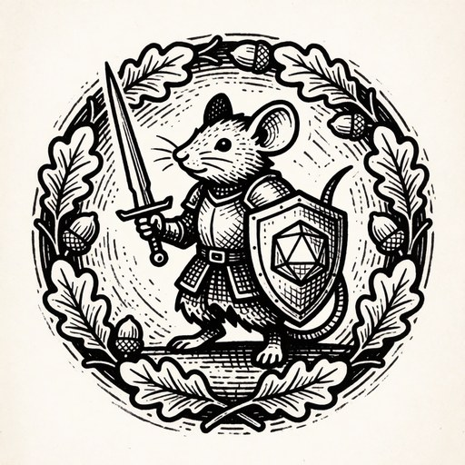
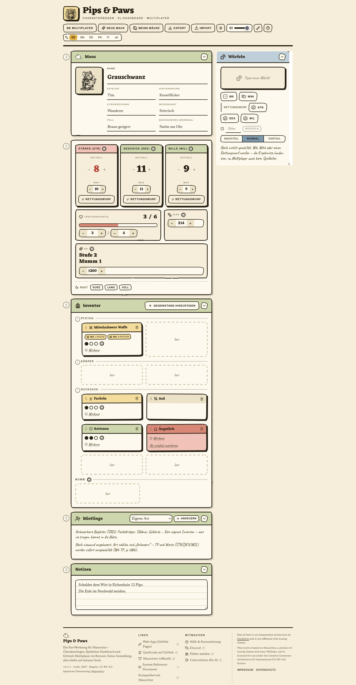
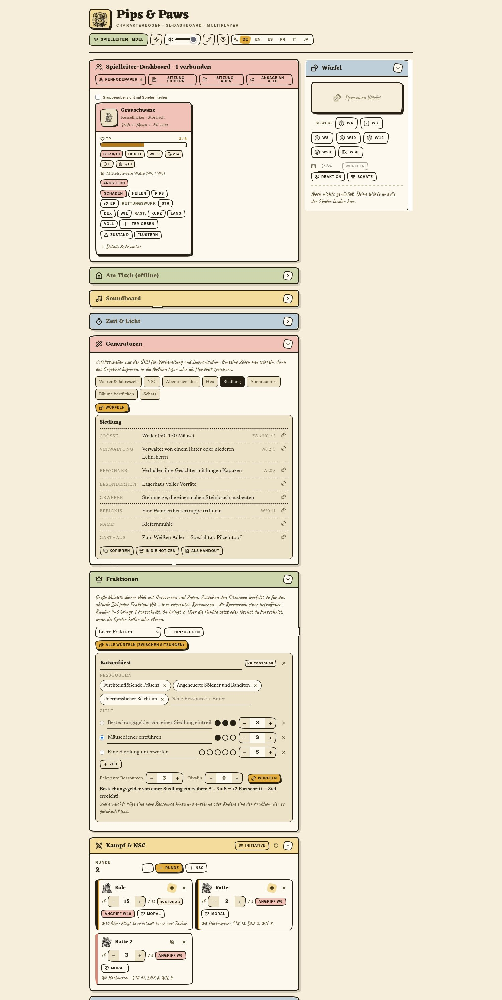
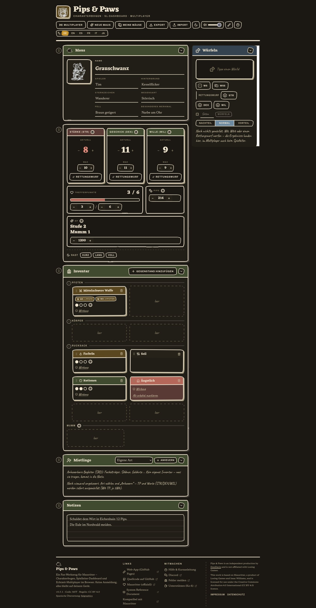
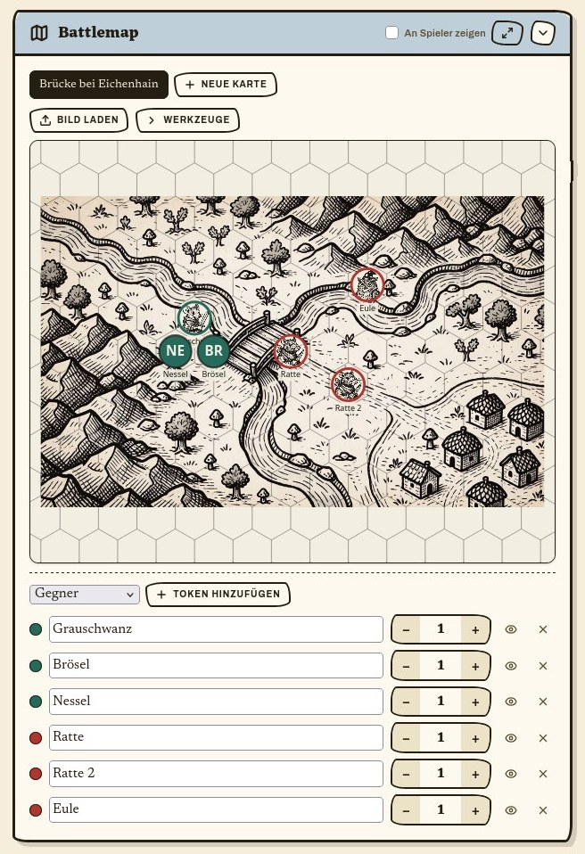

<div align="center">



# Pips &amp; Paws

**Charakterbogen · Spielleiter-Dashboard · serverloser Echtzeit-Multiplayer**
für das Pen-&-Paper-Rollenspiel **Mausritter** — alles im Browser, ohne Anmeldung.

### ▶ [mausritter.redneck-design.de](https://mausritter.redneck-design.de/)

<sub>Deutsch · Englisch · Französisch · Italienisch · Japanisch — alles bleibt lokal im Browser, kein Konto, kein Server</sub>

<sub><a href="README.md">English version →</a></sub>

</div>

<p align="center">
  
  
</p>

---

Öffne die Seite, würfle dir eine Maus zusammen und leg los. Willst du zu mehreren
spielen, eröffnet die Spielleitung einen Raum und teilt einen Link — die Verbindung
läuft direkt zwischen den Browsern (WebRTC), ohne dass Daten über einen Server des
Betreibers laufen.

## Für Spieler:innen

- **Charakterbogen** — STR / GES / WIL (aktuell & Maximum), Trefferpunkte, Pips, EP,
  Mumm, Charakterbild und Notizen. Alles wird automatisch im Browser gesichert.
- **Charaktererschaffung nach SRD 2.3.1** — 3W6 (die zwei höchsten), TP & Pips je 1W6,
  vollständige 36er-Hintergrundtabelle mit Startausrüstung, Schwache-Maus-Regel,
  Sternzeichen · Fell · Merkmal.
- **Inventar per Drag & Drop** — zwei Pfoten, zwei Körper, sechs Rucksack; 1- und
  2-Platz-Gegenstände, Tausch, Nutzungspunkte, Zustände als Kärtchen. Gegenstände und
  Zauber tragen kleine Tusche-Bilder (bisher 73); jeder Gegenstand hat außerdem ein
  Symbol, das sich stattdessen wählen lässt.
- **Würfeln** — W6 und W66 als echte, taumelnde 3D-Würfel; Probe (W20 ≤
  Attribut) mit Vorteil / Nachteil. Ein Klick auf den Schadenswert einer Waffe
  würfelt den Schaden (ein- und zweihändig getrennt). Jeder Wurf landet sichtbar
  im Würfel-Panel.
- **Sprungleiste** — am unteren Rand springst du mit einem Klick zu Steckbrief,
  Werten, Inventar, Karte, Würfeln … (auch im SL-Dashboard); die Reihenfolge der
  Bereiche lässt sich per Ziehgriff umsortieren, das Dashboard nutzt breite Monitore
  in zwei Spalten. Waffen und Gegenstände lassen sich umbenennen, Würfe klackern.
- **Magie** — einen Zauber in der Pfote mit Kraft 1–3 wirken: die Würfel setzen
  [SUMME] und [WÜRFEL] in den Wirkungstext ein, jede 4–6 markiert eine Nutzung,
  Sechsen sind Patzer (je W6 WIL-Schaden, WIL-Probe oder Entkräftet). Jede Zauberkarte
  zeigt ihre Aufladebedingung.
- **Kampf nach Regeln** — verstärkte (W12) und geschwächte (W4) Angriffe, zwei leichte
  Waffen würfeln beide und nehmen das bessere Ergebnis, und „Nach dem Kampf“ würfelt
  W6 je benutzter Waffe, Rüstung und Munition (4–6 markiert; Improvisiertes immer).
- **Zustände & Belastung** — Verletzt, Entkräftet und Belastet geben Nachteil auf die
  passenden Proben; ein Zustand ohne freien Platz wird trotzdem genommen und die Maus
  ist belastet; Pips über 250 brauchen Pip-Beutel; Rasten legen die passenden Zustände ab.
- **Licht, Beute & Pips** — Fackel oder Laterne anzünden, dann markiert der
  Zeit-Tracker des SL alle 6 Züge eine Nutzung; der SL verteilt Beute als EP (1 EP je
  Pip, gleichmäßig auf die Gruppe); Spenden an die Gemeinschaft gibt 1 EP je 10 Pips;
  aus dem Katalog kaufen und Waffen/Rüstung für 10 % je Nutzungspunkt reparieren.
- **Miethelfer tragen eigene 6 Plätze** (2 Pfoten, 2 Körper, 2 Rucksack) — Dinge
  übergeben und zurücknehmen. Ein Schatz-Anteil gibt ihnen 1 EP je Pip über dem
  Tageslohn, aufsteigen wie Mäuse.
- **Automatische Schadenskette nach SRD** — STR-Schaden löst sofort eine
  STR-Probe aus; misslingt er, ist die Maus verletzt und kampfunfähig, bis
  sie rastet. Bei 0 STR stirbt sie — die App löscht oder sperrt dabei nichts von
  selbst, sie sagt es nur unmissverständlich.
- **Rast-Helfer** — kurz / lang / voll, mit Rationsverbrauch und Attributs-Heilung
  nach den Regeln; jede Rast hebt auch „kampfunfähig" wieder auf.
- **Stufenaufstiegs-Helfer** — wer eine neue Stufe erreicht, bekommt einen Hinweis mit dem
  Aufstieg nach Regelbuch: W20 je Attribut (höher als der Wert = +1) und die
  Trefferwürfel der Stufe für die Trefferpunkte, gewürfelt auf der Würfelbühne.
  Schon von Hand erledigt? Ein Klick blendet ihn aus.
- **Miethelfer** — aus dem SRD-Katalog anheuern (Fackelträger, Söldner, Gelehrte, …),
  Werte würfeln sich beim Anheuern selbst, Moralwürfe bleiben lokal auf dem Bogen.
- **Mehrere Mäuse pro Browser** — jede gespielte Maus landet in einer Liste, zu der
  du jederzeit zurückwechseln kannst, ganz ohne manuelles Sichern.

## Für Spielleiter:innen

- **Dashboard** — alle Helden auf einen Blick: Bild, TP, Werte, Rüstung, belegte
  Plätze, Waffen, Zustände.
- **Eingriffe pro Maus** — Schaden, Heilen, Pips, EP, Rast auslösen, Probe
  oder Initiative fordern, flüstern, Ansage an alle, Gegenstand oder Zustand geben.
- **Würfel-Panel** mit Ergebnis-Bühne, Reaktions- und Schatzwurf, Glückswurf (X-in-6),
  einem „Geheim“-Modus, der Würfe aus dem Spieler-Log und Discord heraushält
  (Begegnungswürfe bleiben immer privat), und einem
  Wurf-Protokoll, in dem auch die Würfe aller Spieler auftauchen.
- **Tischmitte** — gemeinsamer Loot-Ablage; Gegenstände lassen sich vorbereiten
  und vor den Spielern verstecken, bis sie „auf dem Tisch" liegen. Mit Namen und
  Platzgrenze (Karren, Truhe): ist das Lager voll, können Spieler nichts mehr ablegen.
- **Bank** — auf jedem Bogen: Pips einzahlen und abheben, Gegenstände einlagern und
  abholen; beim Abholen fällt die Gebühr von 1 % an (Regeln). Die Bank belegt keine
  Inventarplätze, eingelagerte Pips zählen nicht für Pip-Beutel.
- **Zeit & Licht** — Zug-/Wachen-/Tag-Zähler, Fackel- und Begegnungs-Countdown,
  Alarmbanner bei Begegnung oder Vorzeichen, optionale Tageszeit-Anzeige für die Spieler.
- **NSC- & Kampf-Tracker** — Kreaturen aus dem SRD oder eigene, Angriff und
  Moralprobe per Klick, einzelne NSC für die Spieler sichtbar schalten.
- **Sitzung sichern & laden** und allgemeine Notizen.
- **Am Tisch spielen, ohne dass alle ein Gerät brauchen** — Boegen direkt im
  Dashboard anlegen oder laden, Schaden/Heilen/Rast/Gegenstände/Zustände direkt
  darauf anwenden, und den vollen Bogen im Vollbild zum Herumreichen öffnen.
- **Battlemap** — eigenes Kartenbild mit Quadrat- oder Sechsecknetz (Feldgröße und
  Versatz einstellbar), Token, Zeichnungen und Nebel des Krieges, live für die Spieler. Tusche-Porträts
  der SRD-Kreaturen für Token und Kampf-Tracker.
- **Generatoren** — Zufallstabellen aus der SRD, deutsch und englisch: Wetter und
  Jahreszeitenereignisse, NSC, Abenteuer-Ideen, Hexfelder (Art, Wahrzeichen, Detail),
  Siedlungen (Größe, Verwaltung, Bräuche, Gewerbe, Name, Gasthaus), Abenteuerorte
  (Geschichte, Bewohner, Geheimnis), zufällig bestückte Räume (leer, Hindernis, Falle,
  Rätsel, Lager) und Schätze (mit
  magischen und verfluchten Schwertern). Einzelne Zeilen neu würfeln, Ergebnis
  kopieren, in die Notizen legen oder als Handout speichern.
- **Fraktionen** — die SRD-Fraktionsregeln: Ressourcen, Ziele mit Fortschrittsmarken
  und der W6-Wurf zwischen den Sitzungen (SRD-Beispielfraktionen dabei; Teil der
  gesicherten SL-Sitzung).
- **Soundboard** — eingebaute Kurz-Effekte (Erfolg/Fehlschlag/Krit/Patzer/Glocke —
  freie CC0-Sounds von [Kenney.nl](https://kenney.nl/assets/interface-sounds),
  siehe `src/assets/sfx/CREDITS.txt`) plus eigene hochgeladene Ambient-/
  Musikdateien (bleiben auf dem Gerät, gehen live an die Verbundenen).
- **Handouts** — Vorlesetexte und Bilder in einer Bibliothek; einzeln allen oder
  einem Spieler zeigen, der sie auf dem eigenen Gerät behält (Popup + Panel
  „Handouts" auf dem Bogen).
- **PenNodePaper-Brücke** — verbindet das Dashboard mit
  [PenNodePaper](https://github.com/Rec0iL/PenNodePaper), dem KI-gestützten Welten-
  und Story-Baukasten (Dashboard → **PenNodePaper**: Adresse und Pairing-Token
  stehen in PenNodePaper unter ⚙ Einstellungen → *VTT link*). Alles kommt zuerst
  nur beim SL an — die Spieler sehen nur, was du zeigst.

  | PenNodePaper schickt … | … und Pips & Paws macht daraus |
  |---|---|
  | **Handout** (Text oder Bild) | Eintrag in der **Handout**-Bibliothek, auf Wunsch sofort allen oder einem Spieler gezeigt |
  | **Karte** (Bild, Quadratraster, Token) | neue Karte in der **Battlemap** (Raster, Versatz und Token gesetzt; auf Wunsch den Spielern gezeigt). Hex-Raster werden abgelehnt |
  | **Kreatur / NSC** | Eintrag im **NSC- & Kampf-Tracker** als Statblock (TP, Rüstung, Angriffswürfel, WIL); die SRD-Kreaturen kennt PenNodePaper als Vorlagen. Erneutes Pushen aktualisiert und behält die aktuellen TP |
  | **Musik-Stichwort** | eingebauter Effekt oder einer deiner Uploads im **Soundboard** (Audio wird nicht übertragen) |
  | *(Gegenrichtung)* die **Gruppe** | PenNodePaper sieht die verbundenen Mäuse und die Tischbögen, die du führst (ohne Notizen) |

  Kartentoken, die eine geschickte Kreatur nennen, sind ihr Kampf-Tracker-Eintrag (gemeinsame
  TP/STR, durchnummeriert, bei Tod markiert). Die Brücke steckt in `src/pnp/` (Protokoll: [vtt-bridge-spec](https://github.com/Rec0iL/PenNodePaper/blob/main/docs/vtt-bridge-spec.md)).
  Das Pairing-Token bleibt auf dem Gerät und ist nicht Teil einer gesicherten Sitzung.

## Zusammen spielen

- **Serverloser Multiplayer** über WebRTC / PeerJS. Die Spielleitung ist der Host;
  Spieler treten per 6-Zeichen-Code oder `?join`-Link bei. Reconnect und
  Reload-Wiederherstellung sind eingebaut.
- **Verbindungshilfe** — wer in einem strengen Netz sitzt (Mobilfunk, Firmen- oder Hotel-WLAN),
  braucht einen TURN-Relay; mit STUN allein klappen nur direkte Wege. Das Mehrspieler-Fenster hat
  einen Verbindungstest und ein Feld für einen TURN-Server (bleibt auf dem Gerät), gescheiterte
  Beitritte sagen *warum* (WebRTC gesperrt, strenges NAT, Signalisierungsserver nicht erreichbar),
  und der Raum des SL meldet sich nach einem Netz-Aussetzer selbst wieder an. Wer die App selbst hostet,
  baut einen Relay (`VITE_TURN_URLS`, `VITE_TURN_USER`, `VITE_TURN_PASS`) und einen eigenen
  PeerJS-Signalisierungsserver (`VITE_PEER_HOST`, `VITE_PEER_PORT`, `VITE_PEER_PATH`) fest ein.
- **Zugangskontrolle für den Raum** — an ein Gerät geht erst etwas raus, wenn die
  Spielleitung es eingelassen hat. Optionales Raum-Passwort (per Challenge-Response
  geprüft, nie übertragen; auf Wunsch im Einladungslink hinter dem `#`), optional
  „Beitritt bestätigen“ mit Zulassen/Ablehnen, Rauswerfen-Knopf je Spieler (sperrt
  das Gerät) und eine Sperre nach mehreren falschen Passwörtern.
- **Geteiltes Runden-Log** — die Spielleitung schaltet es frei, dann sehen alle
  Spieler die Würfe und Ereignisse der Runde in ihrem eigenen Bogen. Würfe der
  Spieler erreichen die Spielleitung in jedem Fall.
- **Optionaler Discord-Webhook** — spiegelt Würfe und Ereignisse in einen Kanal.
  Die URL liegt nur im `localStorage`, nie in der Charakterdatei.
- **Gruppenübersicht** — der SL kann eine kompakte Sicht der Gruppe teilen (Name,
  TP, Zustände), damit Spieler sich auch untereinander sehen, nicht nur ihren
  eigenen Bogen.

## Gestaltung

Standard ist der **Druckbogen**: Tusche auf Papier, dicke handgezogene Linien,
flache Schmuckfarben, handschriftliche Randnotizen und ein Dunkelmodus als
„Negativdruck". Die Maus ist ein eingebettetes SVG; Wappen,
Bild-Platzhalter und Leerzustände sind Linolschnitt-Illustrationen in schwarzer
Tusche (transparentes WebP, im Dunkelmodus invertiert), keine Stock-Icons für
die Marke. Das frühere App-Design bleibt
als **Klassisch** erhalten — der Pinsel-Knopf in der Kopfzeile schaltet um, die
Wahl wird gemerkt.

## Außerdem

Einklappbare Panels (Zustand gemerkt) · Hell-/Dunkel-Schalter (Klassisch mit
eigenem Hintergrundbild je Modus) · klebender Würfelbereich auf breiten
Bildschirmen · JSON-Export / -Import des Bogens · funktioniert offline aus einer
einzigen Datei.

<details>
<summary>Dunkelmodus</summary>



</details>

<details>
<summary>Battlemap mit Sechseck-Raster</summary>



</details>

## Entwickeln

```bash
npm install
npm run dev        # http://localhost:5173
npm run build      # -> dist/index.html  (eine portable Datei, viteSingleFile)
npm run preview
npm run lint       # oxlint
```

`dist/` ist eine statische Seite (eine `index.html` plus Impressum), die von jedem
Webserver oder direkt von der Festplatte läuft.

**Stack:** Vite + React 19 (plain JS, kein TypeScript), `@dnd-kit` fürs
Inventar-Raster, `peerjs` für den Multiplayer, `lucide-react` für Icons.
Kein Backend, kein Konto.

**Styling:** `src/theme.css` ist das klassische Design und trägt das komplette
Layout; es liegt in `@layer classic`. `src/print.css` ist der Druckbogen (Standard)
— außerhalb der Ebenen, gebunden an `html[data-skin="print"]`, und überschreibt
damit nur Farben, Ränder, Schrift und Schatten, nie den Grid-/Flex-Aufbau. Die
Strichzeichnungen liegen in `src/components/Art.jsx`.

## Mitmachen

Beiträge sind willkommen — besonders Übersetzungen (am besten über den [Discord](https://discord.gg/s6J6JqBQ8w)). Die Oberfläche gibt es
auf Deutsch, Englisch, Spanisch, Französisch, Italienisch und Japanisch. Spanisch
stammt von [@Salgraphics](https://github.com/Salgraphics); FR/IT/JA sind
maschinell unterstützt, Korrekturen von Muttersprachler:innen sehr willkommen.
Kommentierte Vorlagen je Sprache und eine Schritt-für-Schritt-Anleitung liegen in
[`docs/translations/`](docs/translations/GUIDE.md).
Schlüssel, die erst nach dem Spanisch-PR dazukamen (Offline-Tisch-Modus,
Soundboard, Gruppenübersicht, der Druckbogen-Skin, Miethelfer, die Maus-Liste,
die automatische Schadenskette), bleiben in `es.json` absichtlich unübersetzt
und fallen auf Englisch zurück — die Lücke ist Absicht,
damit sie für eine muttersprachliche Übersetzung offen bleibt statt von einer
Maschine vorbelegt zu werden. Ablauf und Schritte für eine neue Sprache:
[`CONTRIBUTING.md`](CONTRIBUTING.md).

## Regeldaten & Bilder

`src/data/*` ist aus dem offiziellen **Mausritter SRD 2.3.1** abgeleitet
(CC BY 4.0). Wirkungstexte sind zusammengefasst, nicht wörtlich übernommen. Die
freien PDFs unter `reference/` liegen nur lokal (Artwork nicht CC BY, per
`.gitignore` ausgeschlossen).

Wappen, Logo, Social-Vorschau, Vignetten, Bild-Platzhalter, Kreaturen-Portraits
sowie die Gegenstands- und Zauber-Illustrationen sind eigene KI-Generierungen
(Krea 2 Turbo über ComfyUI, Linolschnitt in schwarzer Tusche; ältere Quellen in
`img/`, Herstellung der Gegenstandsbilder in `tools/item-art/`), **kein**
offizielles Mausritter-Artwork und **kein** Verlagslogo. Die erzeugten Bilder sind
Outputs im Sinne der [Krea 2 Community License](https://www.krea.ai/krea-2-licensing):
Sie gehören mir, für Outputs verlangt die Lizenz keine Namensnennung, und das
Projekt ist kostenlos und nicht kommerziell. Das Modell selbst wird hier nicht
verteilt.

Die eingebauten Kurz-Effekte des SL-Soundboards (`src/assets/sfx/`) stammen aus
Kenneys ["Music Jingles"](https://kenney.nl/assets/music-jingles)- und
["Interface Sounds"](https://kenney.nl/assets/interface-sounds)-Paketen,
Lizenz [CC0](https://creativecommons.org/publicdomain/zero/1.0/deed.de) — siehe
`src/assets/sfx/CREDITS.txt`.

## Rechtliches

[Impressum &amp; Datenschutzerklärung](https://mausritter.redneck-design.de/impressum.html)
— eine Seite (`public/impressum.html`), im Footer verlinkt. Der Datenschutz-Teil
beschreibt den tatsächlichen technischen Aufbau; bei Änderungen an externen
Diensten oder gespeicherten Schlüsseln anpassen. Wer den Code forkt und selbst
betreibt, braucht ein eigenes Impressum (siehe `CONTRIBUTING.md`).

## Lizenz

Code: **MIT** (`LICENSE`).

> *Pips &amp; Paws is an independent production by DonDavis and is not affiliated with Losing Games.*
>
> *This work is based on Mausritter, a product of Losing Games and Isaac Williams, and is
> licensed for use under the Creative Commons Attribution 4.0 International (CC BY 4.0) licence.*
